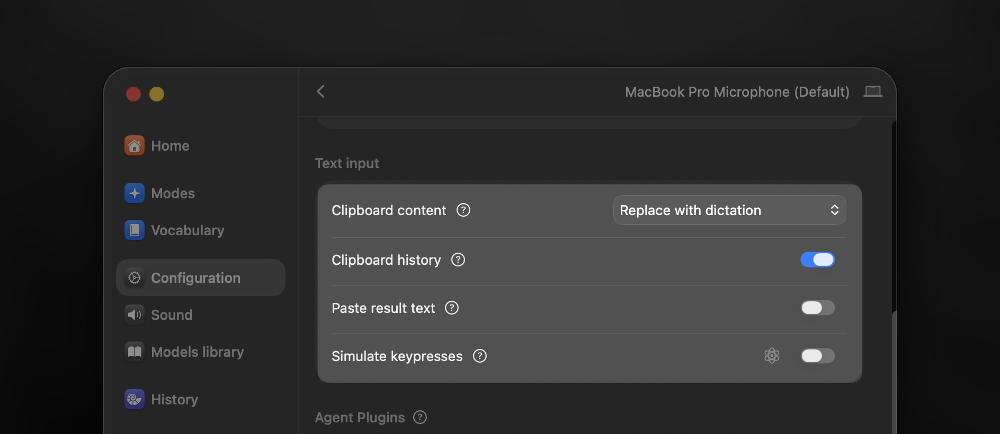

# Macrowhisper

Macrowhisper is an automation helper for [Superwhisper](https://superwhisper.link/robert). Superwhisper turns your voice into text; Macrowhisper watches the resulting recording and decides what to do next.

It can paste or type the result, open a URL, run a macOS Shortcut, run a shell command or AppleScript, and chain several actions together. Actions can be selected by voice phrase, frontmost app, Superwhisper mode, browser URL, or a normal fallback action.

[](https://swift.org)
[](https://www.apple.com/macos/)

> **Before your first dictation:** configure Superwhisper using the [first-use checklist](#first-use) below. Its paste and clipboard settings need to work with Macrowhisper; leaving them at their defaults can cause conflicting clipboard changes or duplicate insertion.

## Requirements

- macOS 12.4 or later. This is the deployment target configured for the current macOS executable.
- [Superwhisper](https://superwhisper.link/robert), configured to save recordings.
- Accessibility permission for the installed `macrowhisper` executable. Macrowhisper uses it for insertion, key simulation, selected text, and app context. Grant it in System Settings → Privacy & Security → Accessibility when macOS prompts you.
- Automation permission may be requested when you use Shortcuts, AppleScript, or System Events actions.

## Install

### Homebrew

```bash
brew install ognistik/formulae/macrowhisper
```

### Install script

```bash
curl -L https://raw.githubusercontent.com/ognistik/macrowhisper/main/scripts/install.sh | sudo sh
```

The script installs the prebuilt release specified in the script and its JSON schema after checking the archive's SHA-256 hash. The release process updates that version and hash. It installs to `/usr/local/bin` by default; pass an absolute directory as the script argument when you need another location.

## First use

Start with these settings in **Superwhisper → Configuration → Text input**, as shown below. Superwhisper supplies the dictation; Macrowhisper's insert actions handle pasting or typing it and restoring your clipboard.

| Superwhisper setting | Recommended value |
| --- | --- |
| Clipboard content | **Replace with dictation** |
| Clipboard history | **On** (recommended; see below) |
| Paste result text | **Off** |
| Simulate keypresses | **Off** |



**Clipboard history: On** lets clipboard-history apps retain Superwhisper's dictations, making them easier to find and reuse. **Off** marks Superwhisper's writes as transient so those apps skip them. Macrowhisper handles transient clipboard activity too, so On is a convenience recommendation, not a requirement for detection. You can choose Off; it controls Superwhisper's writes, while Macrowhisper's own inserts can still produce clipboard-history entries.

Also set Superwhisper's **Recording Window** to **Classic** or **Mini**, its **Cancel recording** shortcut to **Escape (Esc)**, and **Always close** to **Off**. Macrowhisper's default `simEsc: true` lets actions dismiss the recording window with Escape before running. The generated `autoPaste` action skips Escape outside text fields.

If you choose **None** for the recording window or enable **Always close**, set Macrowhisper's `defaults.simEsc` to `false`. See [setup alternatives](docs/getting-started.md#if-you-change-these-settings) for matching options, clipboard restoration, and typing instead of pasting.

Then create the configuration, check its path, validate it, and start the background service:

```bash
macrowhisper --reveal-config
macrowhisper --get-config
macrowhisper --validate-config
macrowhisper --start-service
macrowhisper --service-status
```

`--reveal-config` creates the file when it does not exist and opens it in Finder. The default path is `~/.config/macrowhisper/macrowhisper.json`. A generated configuration creates an `autoPaste` insert and uses it as `defaults.activeAction`, so you can dictate into a normal text field immediately after granting Accessibility permission and starting the service.

The generated `defaults.watch` value follows Superwhisper's configured folder when it can read that setting. A fresh installation normally uses `~/superwhisper`; existing `~/Documents/superwhisper` and custom locations are supported. The value is the Superwhisper folder containing `recordings`, rather than the `recordings` directory itself.

If the recording window does not close reliably, try a small `defaults.actionDelay` such as `0.05` to `0.2` seconds.

## Configuration

`configVersion: 2` is the current configuration format. In action overrides, `null` usually inherits the value from `defaults`, while `""` means an intentional empty value. The generated `$schema` reference is managed automatically when a local schema is available.

To use a different configuration location, pass a file or directory. A directory receives the default filename `macrowhisper.json`:

```bash
macrowhisper --set-config ~/my-configs/
macrowhisper --get-config

# Return to ~/.config/macrowhisper/macrowhisper.json
macrowhisper --reset-config
```

After editing, validate the file. `--update-config` applies current schema and formatting changes while preserving your settings:

```bash
macrowhisper --validate-config
macrowhisper --update-config
```

This small configuration makes ordinary dictation paste into the current text field and turns `ask google ...` into a browser search. Keep the generated `watch` path if it differs from the example because your Superwhisper folder is elsewhere.

```json
{
  "configVersion": 2,
  "defaults": {
    "watch": "~/superwhisper",
    "activeAction": "pasteResult"
  },
  "inserts": {
    "pasteResult": {
      "action": "{{swResult}}"
    }
  },
  "urls": {
    "search": {
      "action": "https://www.google.com/search?q={{result}}",
      "triggerVoice": "ask google"
    }
  },
  "shortcuts": {},
  "scriptsShell": {},
  "scriptsAS": {}
}
```

`{{swResult}}` is the final transcription value. A normal `triggerVoice` pattern matches at the start of the spoken result, and `{{result}}` receives the remaining voice text for the URL. See [configuration](docs/configuration.md), [actions](docs/actions.md), and [triggers and conditions](docs/triggers-and-conditions.md) for the complete behavior.

## Action selection

For a recording, Macrowhisper evaluates actions in this order:

1. one-shot `--auto-return`
2. one-shot `--schedule-action`
3. matching voice, app, mode, or URL triggers
4. `defaults.activeAction`

The first applicable level wins. Trigger matches are ranked by voice, Superwhisper mode, browser URL, then frontmost app; more-specific matches win within a level. `defaults.bypassModes` can skip Macrowhisper processing for selected Superwhisper modes.

## Essential commands

Configuration and service commands do not require a running daemon:

```bash
macrowhisper --help
macrowhisper --version
macrowhisper --get-config
macrowhisper --validate-config
macrowhisper --update-config
macrowhisper --start-service
macrowhisper --service-status
macrowhisper --restart-service
```

Runtime and action commands use the running service:

```bash
macrowhisper --status
macrowhisper --action <name>          # set the fallback action
macrowhisper --action                 # clear the fallback action
macrowhisper --list-actions
macrowhisper --get-action [name]
macrowhisper --copy-action <name>
macrowhisper --exec-action <name>
macrowhisper --run-auto
macrowhisper --schedule-action <name> # use an action for the next session
macrowhisper --schedule-action       # cancel the scheduled action
macrowhisper --auto-return true       # enable one-shot Return behavior
macrowhisper --mute-triggers 10m     # mute triggers temporarily
```

`--exec-action`, `--run-auto`, and `--copy-action` use the latest valid result by default. Use `--meta` to target a recording folder, folder path, or compatible JSON file; the [CLI reference](docs/cli-reference.md) covers those forms and the full command set.

The experimental local configuration editor is currently a developer prototype
with synthetic data. See the [prototype guide](docs/development/web-editor-prototype.md)
to preview Defaults and Inserts; it does not edit your live configuration.

## Documentation

For complete feature explanations, configuration examples, and troubleshooting, start with [the documentation index](docs/README.md).

You can also share the index with an AI assistant and describe what you want Macrowhisper to do. Ask it to read the relevant linked pages to help you set up a workflow, understand a feature, or troubleshoot your configuration.

The [Alfred workflow](alfred/README.md) and [issue tracker](https://github.com/ognistik/macrowhisper/issues) are also available.

If Macrowhisper is useful in your workflow, you can [buy me a coffee](https://buymeacoffee.com/afadingthought/). Macrowhisper is an independent project and is not affiliated with Superwhisper.
