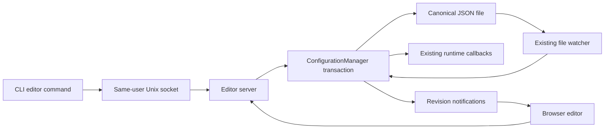

# Local configuration editor plan

[Documentation index](../README.md) · [Development guide](README.md)

Status: approved implementation plan (commit `a440e9a`), prepared September 5, 2026 against `main` at `c88ad1f` (2.2.0). The experimental branch is `feat/web-config-editor`, checked out separately in `../macrowhisper-editor` so the original checkout can remain on `main`. The branch now contains the connected Defaults/Insert slice and matching resource assembly; signed-build and release verification remain gates before publication.

## Current implementation status

The connected editor is served by the running daemon and opened with
`macrowhisper --editor` (or `-e`). `macrowhisper --editor-url` prints the fresh
authenticated URL without opening a browser. Both commands contact the existing
daemon through the same-user Unix socket; they do not start another daemon,
install a service, or change the selected configuration path.

The HTTP server binds to `127.0.0.1`, tries port `49172`, and falls back to an
OS-selected loopback port. A single-use bootstrap token in the URL fragment is
exchanged for a bearer session, then removed from the address bar. The browser
keeps that session in tab-scoped `sessionStorage` for up to eight hours; a new
tab/bookmark or daemon restart requires a fresh editor link. API reads and writes
require the bearer and exact loopback Origin/Host checks.

The JSON configuration remains canonical. The connected writable scope is
Defaults and Inserts; URLs, Shortcuts, Shell, and AppleScript are present for
cross-action context but remain live-snapshot-backed/read-only until their
type-specific editors are implemented. Choices save immediately. Text inputs,
textareas, numeric text, and composite placeholder editing save on blur; there is
no global Save button. Revision, configuration generation, and disk fingerprint
checks reject stale drafts. Explicit `null`, empty strings, `false`, and `0`
remain distinct from omission or inheritance.

Invalid, empty, legacy, future-version, or unknown-field files are reported as a
disk problem and are not rewritten when the editor opens. The runtime fallback
is shown separately. A failed validation or persistence write retains the draft;
an external edit produces a conflict with an explicit review/reapply choice.
Changing the selected configuration path or restarting the daemon invalidates
the old generation/session.

## Product goal and decisions

Give people a comfortable way to configure Macrowhisper without learning JSON. The existing configuration file remains canonical, and manual editing remains supported. The editor presents actions, defaults, inheritance, and conditions as understandable controls over the same behavior.

The brief establishes these decisions:

- Serve a local editor from the existing daemon. Use a predictable loopback port with an available-port fallback and Unix-socket discovery. No editor-port setting in the configuration for the first milestone.
- Add `--editor` and `-e` to open it, and `--editor-url` to print an authenticated opening URL without opening the browser.
- Save discrete choices immediately. Save text inputs and textareas when the user leaves the editing control, including numeric text inputs. No timer-based text autosave and no global Save button.
- Show Defaults first as a direct main-panel destination. Organize Inserts, URLs, Shortcuts, Shell, and AppleScript as contextual rail collections whose concrete actions open in the main panel.
- Show inheritance explicitly and provide action pickers, condition controls, and placeholder insertion. Keep advanced syntax available when richer controls cannot represent it faithfully.
- Build with React, TypeScript, and Vite; ship static assets with Macrowhisper. Node is a development/build dependency only.
- Treat polished light and dark modes as a requirement of the first useful editor. Limit the number of supported screens before lowering their design quality.
- Support manual installation and Homebrew resource layouts before the feature is release-ready.

The first implementation should establish a polished Defaults screen and a complete Insert editing flow. Building all five action editors at once would make the foundational interactions harder to review.

## Findings from the current repository

| Existing foundation | Consequence for the implementation |
| --- | --- |
| [AppConfiguration](../../src/macrowhisper/Config/AppConfiguration.swift) has typed models, custom encoding, and version 2 normalization. | Reuse these semantics. A generic JSON form or dictionary-only mutation layer is insufficient. |
| [ConfigurationManager](../../src/macrowhisper/Config/ConfigurationManager.swift) validates references, conditions, and chains and verifies a temporary file before atomic replacement. | Extract a transaction API around that work. The current `saveConfig()` can return without saving and catches errors despite its `throws` signature; HTTP must not interpret a normal return as successful persistence. |
| The manager has a serial queue, but not every existing write/callback path forms one atomic transaction. | Audit editor, CLI, watcher, startup normalization, and config-path switching together. Do not add HTTP writes around a separate read/modify/save sequence. |
| The loader can fall back to in-memory defaults for invalid files and has recovery side effects for empty files/read failures. | Model disk validity separately from runtime configuration. Editor reads and candidate validation must not invoke a loader that can reset files. |
| [ConfigChangeWatcher](../../src/macrowhisper/Watcher/ConfigChangeWatcher.swift) follows file replacement; manager suppression currently skips the next event. | Preserve replacement and symlink handling, but make internal-write suppression identity-aware so it cannot hide an unrelated external edit. |
| [SocketCommunication](../../src/macrowhisper/Networking/SocketCommunication.swift) creates the per-user socket with mode `0777`. | A socket path containing a UID does not authenticate its caller. Restrict access and verify peer identity before issuing editor credentials. |
| [Swifter is already a dependency](../../src/Package.swift); its resolved implementation defaults to a broad listen address and reads declared request bodies before routing. | Set the loopback address explicitly. Prove dynamic-port discovery and stream cancellation, and enforce request limits before body allocation rather than only inside routes. |
| [SchemaManager](../../src/macrowhisper/Utils/SchemaManager.swift) searches beside the binary, Homebrew share paths, and development locations, with current-directory precedence. | Reuse installation layout concepts, but do not automatically serve executable JavaScript from arbitrary working directories. |

The existing [configuration reference](../configuration.md), [action reference](../actions.md), [conditions](../triggers-and-conditions.md), and [placeholder catalog](../placeholders-and-context.md) remain the canonical behavioral documentation. This plan describes the editor, not another maintained copy of those references.

## Design direction

Reading this as a settings workspace for everyday Superwhisper users, with a restrained monochrome language and familiar macOS interaction patterns. This is a new interface inspired by the user's description of Superwhisper, not a claim to reproduce its current UI or official design tokens.

The requested taste skill is primarily a marketing-page skill and explicitly excludes dense product interfaces. Use accessible form and navigation patterns here. Do not transfer its hero layouts, decorative photography, animation quotas, or section-composition rules into a configuration tool.

### Visual system

- Neutral whites and pale grays in light mode; charcoal surfaces and soft white text in dark mode. Use semantic CSS variables for surfaces, borders, text, selection, focus, and validation states. No decorative color gradients or glass panels.
- Use the local system sans-serif stack, with a system monospace stack only for payloads, paths, and syntax. Start around 14px body text, 13px supporting text, and 22px screen headings; verify readability rather than shrinking everything to fit.
- Use a consistent 4px spacing scale, roughly 36px control heights, 8px control corners, and restrained popover elevation. Group related settings with spacing and section separators instead of a card around every field.
- Keep primary actions monochrome. Use semantic error/warning color sparingly with text and icons so meaning never depends on color alone.
- Default to the system theme and offer System / Light / Dark. Store this presentation preference in the browser, outside `macrowhisper.json`.
- Keep motion limited to short focus, selection, disclosure, and status transitions. Respect reduced motion. Working design values: variance 2/10, motion 2/10, density 5/10, adapted to a daily-use settings tool.
- Use native controls where suitable and a single family of accessible primitives for menus, dialogs, and popovers. Radix Primitives is the proposed foundation because it supplies unstyled behavior that can be designed for this interface. Complex controls still require application-level keyboard and screen-reader testing. [Radix documentation](https://www.radix-ui.com/primitives/docs/overview/introduction).

### Layout and hierarchy

On desktop, use one quiet contextual left rail beside one editing pane. Its root shows Defaults and the action groups. Defaults navigates directly; choosing an action group replaces the rail contents with that group's searchable action list and an `All sections` return control. Browsing a group does not replace the current main panel. Only choosing a concrete action navigates away from the open Defaults or action editor. This keeps quick cross-group browsing without spending width on a second permanent sidebar. Keep a compact page title and save state in a stable location. A compact sidebar status opens secondary editor details for the selected configuration filename, bounded Copy/Reveal actions, and Appearance; the full path stays accessible without becoming permanent copy. Connection and save failures become prominent and offer copyable diagnostics containing schema and revision metadata without exposing those internals in the healthy panel.

Defaults should group fields by purpose: general behavior, insertion, clipboard, recordings, chains/scripts, and advanced settings. Keep these areas sectional, open one at a time, and make each collapsed summary describe its effective behavior rather than expose an implementation-oriented field count. Start with the overview fully collapsed, then remember the last open section or the user's intentionally collapsed state as a browser-local presentation preference. Insert editing uses the same centered card/disclosure rhythm: one overview surface consolidates the stored action name, source, duplicate/delete controls, rename field, and a compact effective-behavior summary. Payload follows as the primary card, then the overrides, conditions, triggers, and chaining that are actually configured. Empty sections offer an explicit Add control instead of rendering every possible schema field. Search should reveal a matching field inside a collapsed group.

On narrow windows, turn the contextual rail into a modal drawer. Opening a group reveals its action list without replacing the main panel; selecting an action closes the drawer onto that editor, whose Back action reopens the corresponding list. No horizontal form scrolling. Verify at 1440, 1024, and 768px widths plus a narrow layout, with 200% zoom and long action names.

The initial frontend milestone must include actual interactive components with synthetic configuration fixtures in both themes. The fixtures must cover a populated Defaults screen, an inherited Insert, a custom override, a built-in template, an invalid field, a conflict, a healthy empty action list, and a disconnected editor. Empty action dictionaries are valid configuration states and must use creation prompts rather than disk-error treatment. The visual review is an iteration milestone, not a requirement for another permission prompt.

## Editing behavior

### Save and draft states

Each field tracks the server value, local draft, and the revision from which editing began. A dirty text field displays `Unsaved`; a submitted change displays `Saving…`; only a successful server response permits a brief `Saved` acknowledgement, which clears after roughly two seconds. Routine status and reset actions occupy stable utility slots that remain visually empty when idle, so their appearance does not resize the setting row. Validation and storage failures retain the draft and explain the problem inline. Save activity does not become part of a collapsed effective-behavior summary. Field-level Revert discards the draft without allowing the same focus transition to start a write; Retry remains explicit after transport failure.

Treat a textarea plus its placeholder toolbar as one editing boundary. Opening the placeholder menu or clicking an insertion pill must not cause a premature blur-save or lose the insertion position. Leaving that composite control validates and commits the resulting text. Respect IME composition and preserve text selections and undo behavior. Enter inserts a newline in textareas; ordinary single-line fields may commit on Enter.

Serialize outgoing mutations per browser tab. Consecutive rapid choices must not let an older response overwrite the newest local selection. A control must remain visibly pending until acknowledged. After an uncertain network result, fetch the current revision before retrying; do not blindly replay an action creation or rename.

Browsing an action group changes only the contextual rail and does not run the destination-navigation flush; ordinary text controls still commit when that interaction moves focus beyond their editing boundary. Selecting a concrete action or Defaults is internal navigation: it attempts to commit a valid text draft before leaving. Invalid/conflicted drafts remain available and navigation offers an explicit discard choice. Register the browser's unsaved-change warning only while drafts or unacknowledged writes exist; browser close warnings are best-effort, so do not depend on an unload request to save data. Do not persist payload drafts into browser local storage by default.

### Controls must preserve meaning

| Concept | Planned control and behavior |
| --- | --- |
| Inheritable boolean | `Use Defaults (On)` / `On` / `Off`. The Defaults choice writes inheritance, not the displayed effective value. An accessible description names the Defaults field. |
| Inheritable number | `Use Defaults (0.3 s)` or an explicit numeric value with its unit. Empty typing is a draft, not zero or an implicit reset. |
| Root default | Show the resolved shipped value with a subdued `Built-in` marker and field-specific `Use built-in` behavior. For ordinary numeric Defaults, blank commits `null`/the shipped value while explicit `0` remains distinct; preserve special nullable meanings such as history retention. Do not give root defaults an action-style parent inheritance control. |
| Action payload | One plain-language mode control chooses Custom text, Auto-paste dictation, or Do nothing without exposing serialized sentinels. `action` is required and has no Defaults payload to inherit. Empty text and `.none` remain separate choices. Replacing non-empty Custom text retains the exact value in tab-scoped editing state and offers an explicit Restore action; this recovery follows navigation and rename but is not written to configuration or browser-local storage. |
| Built-in templates | Show `.autoPaste` and `.none` as named modes with their actual effective settings. Disable or explain controls overridden by the runtime template. Preserve stored sibling values when viewing/changing modes; do not silently rewrite them. The protected auto-paste action visibly explains why Delete is unavailable. |
| `nextAction` | Search all five action groups. Include `Use Defaults (…)` and explicit `None`; exclude the current action and explain known invalid links. Show that default next-step inheritance applies to the root step only. Server chain validation remains authoritative. |
| `defaults.activeAction` | Search existing actions, with a clear `None` option. Label it as the fallback action, not the next step. |
| `moveTo` | Default, Keep recording, Move to folder, Delete recording. Preserve `null`, empty text, a path, and `.delete` respectively. The connected editor uses the authenticated daemon's native directory picker; text entry remains available. |
| `icon` | Default, No icon, or Custom. Do not translate an empty icon to `.none`. |
| `triggerLogic` | Default / Any (OR) / All (AND), with copy about combining configured trigger types. |
| Input conditions | Show only configured rules and offer Add condition for another supported setting. Removing a rule means Always. Explain that an unmet condition generally restores Defaults behavior, while payload behavior has its own rule. These controls serialize tokens without showing pipe syntax as the normal UI. |
| Trigger expressions | Make ordinary alternatives understandable without losing regex, exclusions, or valid manual expressions. If a value cannot round-trip through a builder, keep it editable in an explicitly advanced text control. |
| Placeholders | A compact, categorized `Insert placeholder` menu offers result, captured-context, workflow, recording-folder, and Date sources as full-width rows with a clear name-purpose hierarchy and no repeated raw syntax; common Date formats are direct choices. It opens with no selected row, pointer movement stays neutral, and keyboard navigation introduces a quiet state only after an arrow, Home, or End key. A stable review row counts every complete occurrence without reacting to caret movement or opening automatically after insertion. Review participates in the same one-open-at-a-time disclosure set as Insertion behavior, Conditions, Triggers, and Chaining. Selecting one occurrence opens one inspector; selecting it again closes only the inspector. The inspector source selector mirrors the insertion menu's built-in and direct Date choices, then exposes the complete runtime transform catalog and ordered multiline regex replacements with capture-group guidance plus compact symbolic reordering and removal actions. Replacement edits preserve Return, `\n`, and `\\n` exactly as entered; the runtime's existing ambiguous Insert newline compatibility remains unchanged pending a versioned context-aware escape model. Repeated occurrences remain independent. Custom metadata paths appear as preserved Custom sources and receive the same transform/replacement controls. XML uses a separate exact runtime matcher without transform or replacement suffix support, so XML and structurally unsupported syntax remain exact, raw, and read-only to the inspector. Do not expand placeholders against private live context in the editor. |

An effective-value explanation is a configuration explanation, not a simulation of execution. Conditions depend on runtime focus, built-in templates can override fields, and clipboard stacking/attachments are controlled by the root action for the full chain. Reuse or extract the production resolution rules where necessary, with regression coverage shared across watcher and CLI expectations.

Existing input-condition strings can contain repeated or conflicting tokens; validation accepts these and the runtime uses the last occurrence. A structured control should prevent generating duplicates, but preserve an existing expression in advanced mode until the user deliberately edits it. Do not silently simplify it when loading. Resolve new-configuration watch paths through the backend's `AppConfiguration.defaultConfig()` behavior, not a hardcoded schema example or the lower-level defaults factory, which still contains the legacy folder path.

### Insert action lifecycle

Include creating, duplicating, renaming, and deleting Inserts before calling the first Insert editor complete. Creation uses a local draft until name and required payload are valid, then creates the whole action in one transaction. An explicit Create action is compatible with avoiding a global Save button.

Names are globally unique across all action types. Rename must update relevant `activeAction` and `nextAction` references atomically across the configuration. For deletion, identify inbound references and block until they are changed, rather than silently deleting or clearing dependent configuration. The UI confirms the concrete deletion. Empty lists offer a clear Create Insert action.

## Backend architecture



The dedicated `EditorServer` and resource resolver keep HTTP routing outside
`main.swift`; the entry point owns lifecycle and dependency wiring. Editor
startup belongs to daemon startup after configuration/socket setup, including
the existing missing-recordings-folder recovery flow. Runtime callbacks are
installed before accepting editor mutations. The editor remains available when
no recordings are being watched or the config is invalid.

The implementation binds explicitly to `127.0.0.1`, tries documented port
`49172`, and lets the OS allocate another loopback port when necessary. Multiple
macOS user sessions can coexist. Editor failure does not take down transcription
automation; it is reported through logs and the editor CLI commands.

`--editor` / `-e` requests a fresh opening URL, opens it with the normal macOS browser mechanism, and prints the clean address. `--editor-url` prints only the fresh authenticated opening URL to stdout, with errors on stderr and a nonzero failure status. If opening the browser fails, explain that `--editor-url` can supply a fresh link. Do not start a second daemon or change service installation automatically when these commands fail.

### Authentication and HTTP boundaries

Issue short-lived, single-use bootstrap tokens only to the same-user CLI. Validate the daemon socket's ownership/type on the client and peer UID on the server; review safe handling of pre-existing socket paths and restrict permissions while preserving same-user CLI behavior.

Keep the clean address separate from the credential-bearing opening URL. Prefer a fragment token, exchanged by the local bootstrap page in a same-origin POST and immediately removed with `history.replaceState`. Tokens and config payloads must not appear in request logs, referrers, analytics, or third-party asset requests. The page loads bundled resources only.

The implementation uses an origin-scoped bearer session in tab
`sessionStorage`, supplied explicitly on API requests, with an eight-hour
server-side expiry and invalidation on daemon restart. A clean-URL reload in
the same tab normally remains connected; a new tab or bookmark requires `-e`
or `--editor-url` again. Cookies are intentionally not used for this local
credential flow. The security rationale remains documented in [RFC 6265,
weak confidentiality](https://www.rfc-editor.org/rfc/rfc6265#section-8.5) and
[cookie attributes and localhost behavior](https://developer.mozilla.org/en-US/docs/Web/HTTP/Reference/Headers/Set-Cookie).

Validate exact Host including bound port, reject foreign/null Origins on mutations, require JSON plus an explicit authentication header, deny cross-origin API access, and reject unexpected methods/content types. Protect configuration reads as well as writes. Use no-store for private responses, a restrictive CSP with frame embedding disabled, no-referrer, and nosniff. Serve only a bounded asset root, reject traversal/symlink escapes, and enforce request-size, connection, and timeout limits. SameSite alone is not a complete CSRF defense. [OWASP CSRF guidance](https://cheatsheetseries.owasp.org/cheatsheets/Cross-Site_Request_Forgery_Prevention_Cheat_Sheet.html).

This protects against unrelated websites and other users obtaining editor access; it is not a sandbox against software already executing as the same macOS user. No action-execution, shell evaluation, arbitrary file-read, or remote-access API is part of the first editor. The folder-picker endpoint is a bounded native-UI bridge: it starts one daemon-owned directory panel, returns only the path explicitly selected by the user, and never lists or reads a client-supplied path. The HTTP request returns a short-lived operation ID immediately and the browser polls its authenticated status, so the server worker is never held open by user interaction. The configuration-reveal endpoint accepts no request body and can reveal only the manager's currently selected configuration path; it is not an arbitrary Finder or file-access primitive.

### Configuration transaction contract

Define one manager-owned operation with an expected revision and a bounded set of typed edits. Address fields using structured path segments, not dotted strings that misinterpret punctuation in action names. Distinguish an absent edit, an explicit null value, and removal of a field; decoding a partial patch directly into ordinary optional Codable properties loses this distinction. Allow related edits in one atomic transaction for action creation and rename. Route existing CLI mutations through this same transaction boundary, not merely HTTP edits.

The operation must:

1. Enter the manager's serialization boundary, check configuration identity/path and revision, and read the current disk state without loader recovery side effects.
2. Reject stale, malformed, unsupported-version, or unsupported-field state without replacing it. Initially block editor writes to legacy configurations that require migration; direct users to the existing migration workflow. Do not migrate merely by opening the editor.
3. Copy the typed candidate, apply only allowed edits, and validate the complete result using the existing semantic rules plus appropriate field type/range constraints. Do not impose new global restrictions on hand-edited configurations unintentionally.
4. Encode using the established persistence conventions, verify the candidate through a side-effect-free validator, and use a unique temporary sibling of the resolved target. Preserve intended symlink, file-permission, and schema handling.
5. Recheck the external disk fingerprint as close to replacement as possible, atomically replace the file, and report any failure to the caller. Clean up only the transaction's own temporary file.
6. Publish the committed in-memory configuration, revision, and runtime reconfiguration event only after persistence succeeds, returning the canonical committed snapshot to the caller. Failure must leave both accepted runtime state and the original valid file unchanged.

Distinguish disk identity/fingerprint, disk validity, and accepted runtime revision. Include a configuration generation that changes on path selection and daemon restart so old browser drafts cannot be applied to a different config. Do not depend solely on file modification time or on the watcher having fired already.

A fingerprint check detects normal concurrent edits, but atomic file replacement is not a filesystem compare-and-swap against an arbitrary noncooperating editor. Test the remaining read/replace window, preserve a recoverable pre-write snapshot, and document this boundary accurately. Do not promise universal race-free external editing on the strength of a revision number.

Typed re-encoding may normalize null/omitted fields and formatting. Preserve their documented semantics. Detect unknown keys before edits so unsupported data cannot be silently dropped; the first implementation may enter read-only mode with a specific explanation rather than attempt lossless editing of a future model.

### API and live synchronization

The initial API should expose an authenticated configuration snapshot, schema/UI metadata, validated mutations, and change notifications. Return stable errors with field path segments and a readable message. Distinguish validation failure, stale revision, authentication expiry, invalid disk state, resource mismatch, and persistence failure.

Keep schema-provided types, descriptions, constraints, and examples separate from a thin UI metadata map that supplies labels, groups, control choices, and special semantics. Generate frontend types where practical; do not hand-maintain a second copy of every configuration field. Add coverage that every editable Defaults and Insert field has metadata or a deliberate read-only explanation. Use stable identifiers and backend path mapping for errors, rather than parsing English validation messages.

Prefer SSE for revision notifications if the resolved server supports cancellable bounded streams. With bearer authentication, use a fetch-based stream or choose bounded polling; native EventSource cannot simply be assumed to send an Authorization header. First prove stream cleanup, sleeping/waking browsers, and reconnect behavior. Notifications announce revision/validity, then the browser fetches a fresh snapshot; missed events are harmless after resynchronization.

Clean fields update on external changes. Dirty fields retain their base value and draft; conflicting writes receive a conflict response rather than silently replacing newer data. Initially offer compare/reload/reapply with explicit user choice instead of an automatic merge. Config-path changes cancel pending writes and require resynchronization. Invalid external JSON displays a blocking file error and identifies runtime fallback separately. The editor must never turn fallback defaults into an automatic replacement for the user's broken file.

## Resources, installation, and documentation

Put frontend source in `editor/` at the repository root, with pinned dependencies and a lockfile. Keep generated frontend output and test artifacts under `.build/`. Vite's production output is static; neither its development server nor `vite preview` is the shipped server. [Vite production build guidance](https://vite.dev/guide/build.html).

The shared resource resolver retains existing schema behavior where compatible.
It resolves editor assets from the installed executable/resource root, including
resolved Homebrew symlinks, or the explicit `.build/editor` development path.
It does not give arbitrary working-directory JavaScript precedence and fails
clearly when the required editor entry point or assets are missing.

Target Homebrew layout:

```text
bin/macrowhisper
share/macrowhisper/macrowhisper-schema.json
share/macrowhisper/editor/index.html
share/macrowhisper/editor/assets/...
```

Coordinate resource copying for signed Xcode builds, the SwiftPM developer workflow, manual archives/install/update/uninstall, and the Homebrew formula. The Xcode target copies the built editor directory beside the signed local binary; SwiftPM remains a compile-oriented developer workflow. The release helper builds the frontend before Xcode, verifies the copied resources, and asserts the deterministic archive layout below. The installer replaces the binary and owned share tree as one staged update, preserving the prior pair if replacement fails. The Homebrew formula is maintained in the separate formula repository; prepare and test a coordinated formula change without publishing it as part of local development.

Test both Apple Silicon and Intel prefix layouts, executable symlinks, paths containing spaces, and an offline launch from an unrelated working directory. Ensure an upgrade cannot leave an old editor paired with a new API and uninstall removes only owned editor assets.

Read the [release guide](releasing.md) before changing release tooling. Testing package construction does not require publishing a release, changing the live Homebrew tap, installing over the user's binary, or modifying launchd. Existing release versions and credentials remain outside this feature's work.

As implementation lands, update root setup/basic usage, CLI help and [CLI reference](../cli-reference.md), relevant configuration/action topics, [codebase map](codebase-map.md), development/resource build instructions, release packaging instructions, and the documentation index. Add a dedicated editor user page when real editor behavior exists; do not document proposed commands as already available.

## Implementation sequence and completion gates

| Milestone | Work and evidence needed to finish |
| --- | --- |
| Design the working controls | Complete for the fixture-backed React shell, Defaults and Insert screens, both themes, inheritance controls, placeholder insertion, blur saving, and error/conflict states. Continue the browser accessibility audit before release. |
| Establish safe transactions | Implemented the manager-owned revision/disk transaction and focused regression seams. Keep valid/invalid/stale edits, failed writes, symlinks, unknown fields, and interleaved CLI/watcher/editor updates covered. |
| Prove local access | Implemented loopback lifecycle, bounded resources, same-user bootstrap, auth/session handling, and CLI opening commands. Signed runtime verification of bind addresses, port fallback, browser re-open behavior, and failure states remains a release gate. |
| Connect the useful slice | Complete for the connected Defaults/Insert controls, Insert lifecycle, live synchronization, drafts, recovery, and actual canonical JSON changes. URL, Shortcut, Shell, and AppleScript actions are browsable through the same contextual rail and concrete selections open read-only panels; their type-specific editors remain future work. The Vite preview remains fixture-backed. |
| Package and verify | Release and install scripts now build frontend assets first and package/validate the binary, schema, and editor tree. Build and verify a signed manual-test binary and exercise offline resource layouts and installer fixtures before publication. |
| Expand action coverage | Reuse the proven architecture for URLs, Shortcuts, Shell, and AppleScript. Add their required/type-specific fields and richer text editing; only then tackle optional advanced builders or execution previews. |

Frontend design work and backend transaction work can proceed independently with a shared contract and synthetic fixtures. Delegate bounded tasks with explicit file ownership; integrate and review before parallelizing further. Keep changes small enough to review as coherent commits. Periodically bring main-branch changes into the experimental branch; do not merge or publish the editor until its release gates pass.

### Required regression and manual scenarios

- Invalid types, missing payloads, invalid conditions/trigger logic, duplicate names, missing references, and cycles never replace a valid config. Failed writes never produce `Saved` or a runtime commit.
- Inheritance survives Default / explicit / Default changes. Test empty strings, explicit false, zero, root resets, built-in sentinel templates, root-only chain defaults, and clipboard root ownership.
- Immediate toggle changes, blur commits, IME entry, placeholder insertion, long payloads, contextual group browsing, concrete action navigation, Defaults navigation, deletion references, and failed requests retain predictable draft behavior.
- Two tabs and external JSON edits cannot silently apply stale browser mutations. Test external edits arriving before the watcher, during internal-write suppression, successful and failed config path switches, symlink target changes, invalid/empty files, startup callback ordering, and reconnect after daemon restart.
- Unauthenticated reads and writes, foreign/null Origins, incorrect Hosts, cross-origin preflights/forms, token replay/expiry, other-user socket access, path traversal, oversized requests, and missing assets fail safely. Verify sockets are listening only on the intended loopback address.
- Existing configuration runners for defaults, chains, input conditions, and trigger logic remain green. Add focused production-backed regression runners for the new transaction and server contracts; the Swift package has no test target.
- Complete real-browser flows in Safari and a Chromium browser, both themes, keyboard-only navigation, screen-reader labels, 200% zoom, and narrow windows. Verify error contrast and disabled/inherited controls remain readable.
- Run daemon/watch-folder/CLI integration using the signed workflow in an explicitly isolated test setup. The existing `--config` option persists selection and communicates with the running daemon; a worktree alone does not isolate runtime state. Design the test harness before invoking service-affecting commands.

## Remaining decisions to resolve during implementation

The engineering choices are now explicit: the default port is `49172` with an
OS-selected loopback fallback; sessions are bearer tokens in tab-scoped
`sessionStorage`, valid for up to eight hours and invalidated on daemon restart;
the browser uses bounded polling; and the compatible resource layout is
`bin/macrowhisper` plus `share/macrowhisper/macrowhisper-schema.json` and
`share/macrowhisper/editor/{index.html,assets/...}`. The remaining product scope
decision is intentional: type-specific editing for URLs, Shortcuts, Shell, and
AppleScript follows the connected Defaults/Insert slice. Unsupported expressions
and fields stay visible/read-only rather than being silently rewritten.
